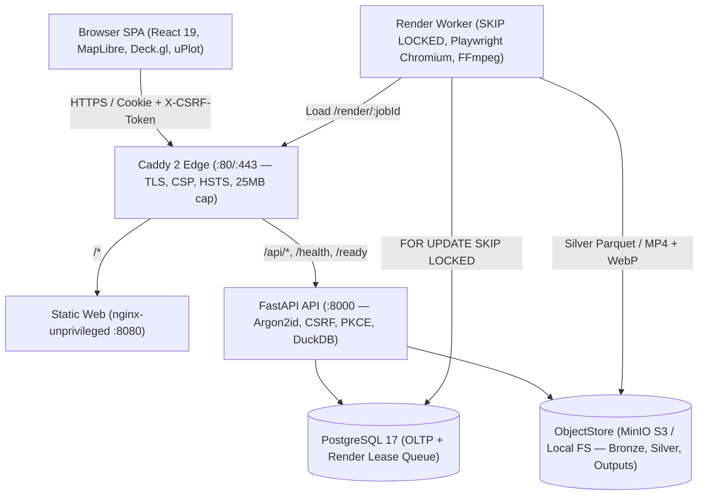

# Trip Animator

Turn a collection of GPS tracks into a shareable animated trip film. A ride spanning several days is more than a line on a map: it has stages, elevation, pace, and places worth stopping for. Trip Animator brings those pieces into one editor so a rider can shape the story and export a video.

**Workflow:** create a trip, import GPX/TCX tracks or connect Strava, arrange stages and their presentation, preview the synchronized map and telemetry, then queue an MP4 render. The product also includes optional trip sharing and playback. Strava connection requires a separately configured OAuth application.


The screenshot is from the running local editor, showing five consecutive cycling days (August 1–5): nine GPX stages totaling 751.0 km, grouped by their recorded dates and published with the route owner's permission. The basemap was allowed to finish loading before capture; tiles require network access. The source activity files and photos are not included in this repository. Basemap: [OpenFreeMap](https://openfreemap.org), © [OpenMapTiles](https://openmaptiles.org) and © [OpenStreetMap contributors](https://www.openstreetmap.org/copyright).

For a privacy-safe demo without personal activity data, generate a fictional GPX with `python docs/demo/generate_synthetic_gpx.py /path/to/demo.gpx` and import it into a new trip.

### What it does

- Combines multi-stage trip data into an interactive map-and-telemetry editing workspace.
- Lets users adjust stage presentation and inspect elevation, speed, and route context.
- Produces MP4 video and thumbnail outputs through an asynchronous browser-based render worker.
- Supports share/playback views; exact availability depends on a running, configured API and storage services.

### Why this architecture

The browser editor and render harness use the same React/map presentation, helping keep preview and exported frames aligned. A Python ingestion pipeline normalizes track data into columnar storage for analysis, while a separate worker handles longer video jobs without blocking editing. PostgreSQL stores application state and jobs; object storage holds track artifacts and renders. The optional Airflow project is for scheduled analytics and maintenance, not required for the core editor.

### Project status and limitations

This is a **beta, self-hosted project**, not a hosted consumer service or production-readiness claim. You operate the application, database, object storage, backups, TLS, and any configured external integrations. Local QA has exercised GPX/TCX ingestion, share/playback, the mobile header, and a five-second 1280×720 flat-mode MP4 render. It has **not** established real Strava OAuth behavior, manual FIT import, full-length 1080p export, or terrain/3D rendering. These paths may require further validation; rendering cost and success depend on the host and map-tile availability.

### Operational security notice

The repository implements security controls, but this README is not an independent security audit, penetration test, or guarantee that a particular deployment is secure. Review and configure the deployment for your environment before exposing it to a network. Use strong unique secrets, restrict ingress and egress, protect uploaded location data and share links, keep dependencies and base images current, and set up backups, monitoring, retention, and incident response. Prefer synthetic GPS data for demos and screenshots. Publishing real route imagery requires the route owner's explicit permission and still reveals the visible locations; keep source activity files and private photos out of the repository.

---

## Architecture



### Workspace Layout

| Path | Stack | Responsibility |
| :--- | :--- | :--- |
| `apps/web` | React 19, TypeScript, Vite, Tailwind v4, TanStack Router/Query, Zustand, MapLibre GL JS v5, Deck.gl, uPlot | Dashboard, 3-pane trip studio, synchronized telemetry scrubber, export drawer, and `/render/$jobId` frame harness |
| `apps/api` | Python 3.12, FastAPI, SQLAlchemy 2.0, Alembic, Argon2id, `httpx` | Auth/CSRF, project/stage authoring, GPX & Strava ingestion, DuckDB OLAP queries, SSE render progress, retention reaper CLI, `/health`, `/ready`, `/metrics` |
| `packages/telemetry` | `defusedxml`, Polars, PyArrow, DuckDB | Isolated GPX parser, Silver GeoParquet ETL, Douglas-Peucker multi-LOD simplification, LTTB chart downsampling, `dbt-duckdb` integration |
| `dbt/` | `dbt-duckdb` | Declarative Silver → Gold SQL models (`stg_telemetry_points`, `mart_stage_summary`, `mart_trip_daily_summary`) and data quality tests |
| `airflow/` | Apache Airflow 3, `dbt-duckdb`, `trip-api`, `trip-telemetry` | Optional scheduled orchestration (`trip_dbt_gold_pipeline`, `trip_strava_incremental_sync`, `trip_platform_maintenance_and_audit`) |
| `apps/worker` | Playwright Chromium, FFmpeg/ffprobe, `psycopg`, `boto3` | Lease-based PostgreSQL queue worker driving `/render/$jobId` frame-by-frame to verified H.264 MP4 + WebP thumbnails |
| `infra/` | Docker Compose, Caddy 2, Nginx unprivileged | Hardened non-root, read-only container stack (`postgres`, `minio`, `minio-init`, `migrate`, `api`, `worker`, `web`, `caddy`) |

---

## Medallion Data Pipeline (`Bronze → Silver → Gold`)

1. **Bronze (`bronze/{project_id}/{stage_id}/...` in `ObjectStore`)**
   - Immutable raw uploaded `.gpx` XML files (≤ 25 MiB) and raw Strava activity + streams JSON payloads.
   - GPX files are parsed inside an isolated subprocess (`parse_gpx_with_timeout`) using `defusedxml` with a 15-second wall-clock timeout and strict depth/track/segment/point limits.
2. **Silver (`silver/{project_id}/{stage_id}.parquet` via `Polars` + `PyArrow`)**
   - Canonical point telemetry schema (`trip_id`, `stage_id`, `seq`, `ts_utc`, `lat`, `lon`, `elev_m`, `delta_dist_m`, `cum_dist_m`, `speed_mps`, `grade_pct`, `hr_bpm`, `cadence`, `watts`, `segment_idx`, `is_moving`).
   - Applies antimeridian longitude unwrapping (`unwrap_longitudes`), coordinate bounds filtering, non-destructive trim windows (`trim_start_s` / `trim_end_s`), and multi-LOD Douglas-Peucker simplification (`full`, `medium`, `low`).
3. **Gold (`dbt/` via `dbt-duckdb` + DuckDB)**
   - Staging & mart models:
     - `stg_telemetry_points` — validated coordinate-bounded Silver points.
     - `mart_stage_summary` — per-stage distance, ascent/descent, moving/elapsed time, VAM (`vam_m_per_h`), max grade, and HR/power averages.
     - `mart_trip_daily_summary` — per-trip daily rollups across stages.
   - Data quality tests in `dbt/models/marts/schema.yml` (`not_null`, `unique`) and `dbt/tests/assert_monotonic_distance.sql`.
   - Online DuckDB endpoints serve LTTB-downsampled charts (`GET /api/v1/projects/{project_id}/telemetry/chart`), simplified map geometry (`GET /api/v1/projects/{project_id}/telemetry/geometry`), and project KPIs (`GET /api/v1/projects/{project_id}/kpis`).

---

## Security implementation notes (not an audit)

The following controls are present in the code/configuration; their listing is not evidence of independent verification or a complete security assessment. Deployment-specific risks remain the operator's responsibility.

- **Authentication & Sessions (`A07`, `A01`)**: Passwords hashed with **Argon2id** (`argon2-cffi`); constant-time login dummy verification prevents user enumeration. 256-bit opaque session tokens stored strictly as `SHA-256` HMAC digests in PostgreSQL `sessions`; cookies set `HttpOnly`, `SameSite=Lax`, `Path=/`, and `Secure` in production.
- **CSRF & Rate Limiting (`A01`, `A04`)**: State-changing routes validate `X-CSRF-Token` using `hmac.compare_digest`. Login, GPX/Strava import, and render creation enforce persistent PostgreSQL-backed rate limits (`rate_limits`).
- **Fail-Closed Production Guards (`A05`)**: When `APP_ENV=production`, startup refuses `DEV_AUTH_ENABLED=true`, default/short `SESSION_SECRET` (< 32 chars), placeholder `TOKEN_ENCRYPTION_KEY`, or missing S3 credentials. `/api/docs` and `/api/openapi.json` are disabled in production, and `GET /metrics` fails closed unless `METRICS_TOKEN` is configured.
- **Strava OAuth2 PKCE & Token Encryption (`A02`)**: Import-only OAuth2 **PKCE (`S256`)** with single-use, session-bound `state`. Access and refresh tokens are encrypted at rest with versioned **AEAD (`AES-256-GCM`)** bound to user/provider AAD (`oauth:{user_id}:strava`). Supports explicit disconnect + Strava deauthorization webhook purge.
- **SSRF, XXE & Command Injection Prevention (`A03`, `A10`)**:
  - `defusedxml` blocks DTDs, external entities, and billion-laughs expansion in an isolated subprocess.
  - Outbound `httpx` calls and Playwright `page.route()` enforce explicit host allowlists (`www.strava.com`, `MAP_TILE_ALLOWLIST`, `RENDER_BASE_URL`), block `file://`/non-HTTP schemes, block HTTP redirects, and reject RFC1918/loopback/link-local/ULA IPs.
  - `ffmpeg` and `ffprobe` execute with fixed `argv` lists (`shell=False`) and `-` path guards; `LocalObjectStore` rejects path traversal.
- **Container & Edge Hardening (`A05`, `A09`)**: Caddy enforces CSP, HSTS, `X-Frame-Options: DENY`, `X-Content-Type-Options: nosniff`, `Referrer-Policy`, `25MB` max upload body, and blocks external `/metrics` access (`403`). Application containers run as non-root (`10001`/`101`) with `read_only: true`, `cap_drop: ALL`, and `no-new-privileges:true`.

---

## Local Development Setup

### Prerequisites
- Python 3.12+ with [`uv`](https://docs.astral.sh/uv/)
- Node.js 24+ with [`pnpm`](https://pnpm.io/) v11
- Docker Engine with the Docker Compose plugin (the bootstrap starts this repo's PostgreSQL service)
- `ffmpeg` and Playwright Chromium are optional; install them only if running the local render worker

### 1. Bootstrap local development

From the repository root, run:

```bash
make bootstrap
```

This runs `scripts/bootstrap-local.sh`: it creates `.env` from `.env.example` only when `.env` is absent, installs the locked Python and JavaScript dependencies, starts the Compose PostgreSQL service, waits for its health check, and applies Alembic migrations. It does not start the API, web app, object store, or render worker. Review `.env` locally before starting services; do not share it.

Bootstrap is local-only: it refuses `APP_ENV=production`, non-loopback database hosts, URL query/fragment options, and libpq host/service overrides. Existing process variables take precedence over `.env`. Set `POSTGRES_PORT` and the port in `DATABASE_URL` together when the default local PostgreSQL port is occupied.

Create a local user account (or use dev-login when `DEV_AUTH_ENABLED=true` in `APP_ENV=development`):

```bash
uv run python -m trip_api.cli create-user \
  --email rider@example.com \
  --password "correct-horse-battery-staple" \
  --display-name "Alpine Rider"
```

### 2. Start Services

Run each in a separate terminal:

```bash
# Terminal 1: FastAPI backend (:8000)
make dev-api

# Terminal 2: Vite React frontend (:5173, proxies /api to :8000)
make dev-web

# Terminal 3 (optional, for MP4 rendering): Render worker
uv run python -c "from trip_worker.runner import run_worker_loop; run_worker_loop()"
```

---

## Strava OAuth2 Setup

1. In your [Strava API Application settings](https://www.strava.com/settings/api), set **Authorization Callback Domain** to:
   - `localhost` for local development or local Docker Compose, or
   - your production domain (e.g., `trips.example.com`).
2. Configure `.env`:
   - `STRAVA_CLIENT_ID=<your-client-id>`
   - `STRAVA_CLIENT_SECRET=<your-client-secret>`
   - `STRAVA_REDIRECT_URI`:
     - Local Vite dev: `http://localhost:5173/strava/callback`
     - Docker Compose (Caddy HTTP): `http://localhost/strava/callback`
     - Production HTTPS: `https://<your-domain>/strava/callback`
   - Optional webhook verification token: `STRAVA_VERIFY_TOKEN=<random-secret>`

> Note: The SPA route `/strava/callback` receives the Strava redirect and invokes `GET /api/v1/strava/callback` using your authenticated session cookie.

---

## Docker Compose Deployment

`infra/compose.yaml` orchestrates the complete hardened stack (`postgres`, `minio`, `minio-init`, `migrate`, `api`, `worker`, `web`, `caddy`).

```bash
# Validate Compose configuration
make compose-config

# Build and launch the full stack
docker compose -f infra/compose.yaml --env-file .env up -d --build
```

For production (`APP_ENV=production`), ensure `.env` overrides all secrets (`POSTGRES_PASSWORD`, `SESSION_SECRET`, `TOKEN_ENCRYPTION_KEY`, `S3_ACCESS_KEY_ID`, `S3_SECRET_ACCESS_KEY`, `METRICS_TOKEN`), sets `DEV_AUTH_ENABLED=false`, and sets `DOMAIN` + `ALLOWED_ORIGINS` for Caddy automatic TLS.

### Observability & Retention Reaper

- **Liveness**: `GET /health` → `200 {"status":"ok","service":"trip-api","env":"..."}`
- **Readiness**: `GET /ready` → `200` when `SELECT 1` succeeds against PostgreSQL, `503` otherwise
- **Metrics**: `GET /metrics` (internal `api:8000/metrics`, blocked at Caddy edge, Bearer-gated by `METRICS_TOKEN`, zero PII)
- **Retention Reaper**: Prunes expired `sessions`, expired `oauth_states`, stale `rate_limits`, and terminal `render_jobs` + ObjectStore `.mp4`/`.webp` artifacts past `RENDER_RETENTION_DAYS` (default `7`):

```bash
# Dry-run preview
uv run python -m trip_api.cli reap --dry-run --json

# Execute prune
uv run python -m trip_api.cli reap
```

In Docker Compose, run the reaper on a host cron or systemd timer:

```bash
docker compose -f infra/compose.yaml exec -T api python -m trip_api.cli reap
```

### Optional Apache Airflow 3 Orchestration (`--profile airflow`)

Airflow is isolated in its own standalone project (`airflow/pyproject.toml`) and disabled by default so the core stack remains lean. When enabled with `--profile airflow`, `airflow-init` provisions a dedicated PostgreSQL database (`${AIRFLOW_DB:-airflow}`) to avoid `alembic_version` collisions, and `airflow` exposes the UI on loopback `127.0.0.1:${AIRFLOW_PORT:-8081}` (`read_only: true`, UID `10001`):

- `trip_dbt_gold_pipeline` (`0 * * * *`): Discovers Silver GeoParquet objects, stages them locally, runs `dbt-duckdb`, atomically swaps `trip_analytics.duckdb` into `GOLD_OUTPUT_DIR`, and verifies mart parity.
- `trip_strava_incremental_sync` (`*/30 * * * *`): Syncs active Strava OAuth connections via dynamic task mapping using AEAD token decryption/refresh, SSRF outbound guards, per-user activity deduplication, and zero tokens in XCom.
- `trip_platform_maintenance_and_audit` (`0 3 * * *`): Executes `reap_expired`, reconciles PostgreSQL `Stage`/`RenderJob` records against `ObjectStore`, and validates Silver GeoParquet schemas and metadata.

```bash
# Start stack with optional Airflow orchestration
make airflow-up

# Run Airflow DAG integrity + pure-Python task tests
make test-airflow
make lint-airflow
```

---

## Testing, Linting & Verification

```bash
# Workspace targets
make lint           # ruff check apps packages + eslint
make typecheck      # mypy --strict + tsc --noEmit
make test           # pytest (telemetry, api, worker) + vitest
make dbt-parse      # uv run dbt parse --project-dir dbt --profiles-dir dbt
make compose-config # docker compose -f infra/compose.yaml --env-file .env.example config --quiet

# Individual package checks
uv run pytest apps/api/tests -v
uv run pytest apps/worker/tests -v
uv run pytest packages/telemetry/tests -v
uv run ruff check apps/api
uv run mypy apps/api
pnpm --filter @trip-animator/web build
```

See [docs/ARCHITECTURE.md](docs/ARCHITECTURE.md), [docs/THREAT_MODEL.md](docs/THREAT_MODEL.md), and [docs/TASKS.md](docs/TASKS.md) for deeper technical specifications.
