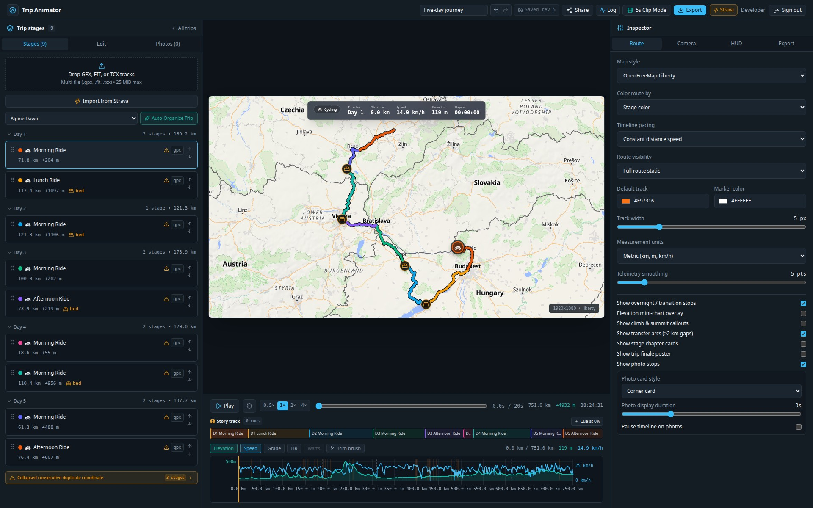
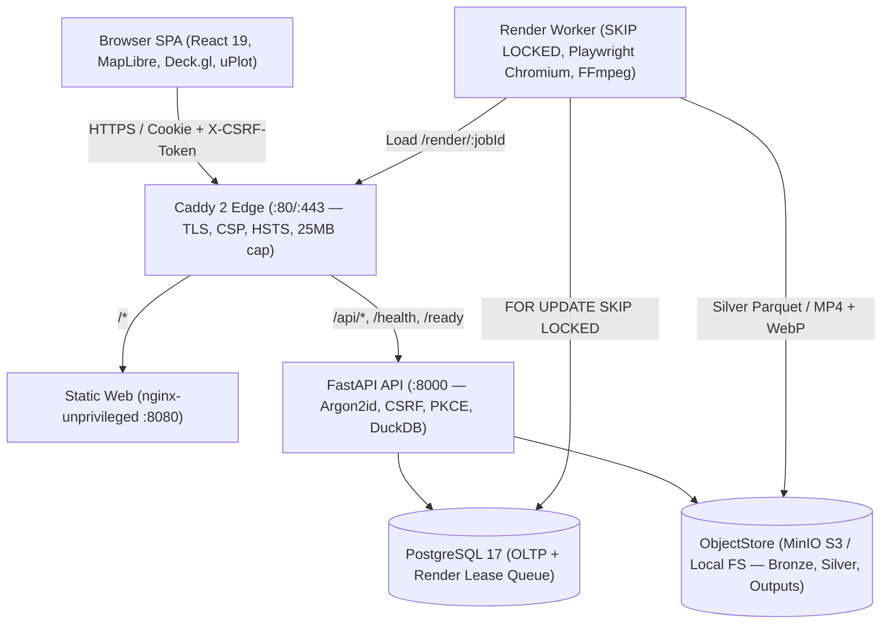

# Trip Animator

Trip Animator turns GPX/TCX tracks (or Strava activities, via an optional OAuth app you configure) into an animated multi-day trip film. A browser editor lets you arrange stages, preview the synchronized map and elevation/speed telemetry, and queue an MP4 render. Sharing and playback views are included.



The screenshot is from the running local editor: five consecutive cycling days (August 1–5), nine GPX stages totaling 751.0 km, published with the route owner's permission. Source activity files and photos are not in this repository. For a demo without personal data, run `python docs/demo/generate_synthetic_gpx.py /path/to/demo.gpx` and import the result into a new trip.

Basemap: [OpenFreeMap](https://openfreemap.org), © [OpenMapTiles](https://openmaptiles.org) and © [OpenStreetMap contributors](https://www.openstreetmap.org/copyright).

**Status:** beta, self-hosted. See [docs/OPERATIONS.md](docs/OPERATIONS.md) for what has and has not been validated.

[](https://github.com/RurociagDanych/trip-animator/actions/workflows/ci.yml)

## Architecture



Data flows Bronze (raw GPX/Strava payloads) → Silver (Parquet via Polars) → Gold (dbt-duckdb marts). Details in [docs/ARCHITECTURE.md](docs/ARCHITECTURE.md).

## Key design decisions

- **Editor and render harness share one React/map presentation.** The worker drives the `/render/$jobId` route of the same SPA, so exported frames match the preview. Trade-off: rendering needs a headless Chromium and map-tile access, and render cost depends on the host.
- **Columnar ingestion pipeline (Polars/PyArrow → Parquet, DuckDB/dbt for analytics).** Telemetry is normalized once into a canonical point schema with multi-LOD simplification and queried with DuckDB, so charts and map geometry stay responsive on large tracks. Trade-off: more moving parts than storing points in PostgreSQL.
- **Separate async render worker on a PostgreSQL queue.** Jobs are leased with `FOR UPDATE SKIP LOCKED`, so long renders never block editing and no extra broker is needed. Trade-off: throughput is bounded by PostgreSQL polling and worker count.
- **Untrusted GPX is parsed in an isolated subprocess.** `defusedxml` with hard size, depth and time limits contains malformed or hostile files. Trade-off: per-upload process overhead.
- **Airflow is required for Strava Vault synchronization.** It runs alongside the default Compose stack; library browsing and GPX import remain available without it, while sync requests wait for recovery. Other scheduled DAGs are opt-in. Trade-off: an additional service to operate.
- **Fail-closed production config.** With `APP_ENV=production` the API refuses to start on dev auth, weak secrets or missing S3 credentials. Trade-off: more required configuration. See [docs/SECURITY.md](docs/SECURITY.md).

## Scale & limits

| Limit | Value | Source |
| :--- | :--- | :--- |
| GPX upload size | 25 MiB | `MAX_GPX_BYTES` in `packages/telemetry/src/trip_telemetry/gpx_parser.py`; Caddy `max_size 25MB` in `infra/Caddyfile` |
| Tracks / segments / points per GPX | 20 / 1,000 / 500,000 | `MAX_TRACKS`, `MAX_SEGMENTS`, `MAX_POINTS` in `gpx_parser.py` |
| GPX parse timeout | 15 s | `PARSE_TIMEOUT_SECONDS` in `gpx_parser.py` |
| Photo upload size | 15 MiB | `MAX_PHOTO_BYTES` in `apps/api/src/trip_api/routers/photos.py` |
| Render artifact retention | 7 days (default) | `RENDER_RETENTION_DAYS` in `infra/compose.yaml` |

## Quick start

Prerequisites:

- Python 3.12+ with [`uv`](https://docs.astral.sh/uv/)
- Node.js 24+ with [`pnpm`](https://pnpm.io/) v11
- Docker Engine with the Docker Compose plugin (the bootstrap starts this repo's PostgreSQL service)
- `ffmpeg` and Playwright Chromium are optional; install them only if running the local render worker

```bash
make bootstrap                      # .env, deps, local PostgreSQL, migrations
uv run python -m trip_api.cli create-user --email rider@example.com \
  --password "<choose-a-password>" --display-name "Rider"
make dev-api                        # FastAPI on :8000
make dev-web                        # Vite on :5173
```

### Required Apache Airflow 3 Orchestration

Airflow is included in the default Compose stack and is required to execute Strava Vault synchronization. Catalog browsing and GPX import remain available when it is stopped; sync requests stay queued until it recovers. The isolated project (`airflow/pyproject.toml`) uses a dedicated PostgreSQL database (`${AIRFLOW_DB:-airflow}`), avoiding application migration collisions. The supervised single-host runtime exposes its UI only on loopback `127.0.0.1:${AIRFLOW_PORT:-8081}` (`read_only: true`, UID `10001`). API and execution JWT keys are persisted in the Airflow logs volume unless explicitly configured. The sync DAG starts unpaused; other schedules are opt-in:

- `trip_dbt_gold_pipeline` (`0 * * * *`): Discovers Silver GeoParquet objects, stages them locally, runs `dbt-duckdb`, atomically swaps `trip_analytics.duckdb` into `GOLD_OUTPUT_DIR`, and verifies mart parity.
- `trip_strava_incremental_sync` (`* * * * *`): Drains the durable Vault queue in bounded batches, resumes historical backfill and rate-limited jobs, and schedules incremental reconciliation every 30 minutes. Activities without GPS are retained; synchronization never creates projects or stages. Tokens remain out of XCom.
- `trip_platform_maintenance_and_audit` (`0 3 * * *`): Executes `reap_expired`, reconciles PostgreSQL `Stage`/`RenderJob` records against `ObjectStore`, and validates Silver GeoParquet schemas and metadata.

```bash
# Start just the orchestrator (also included in normal docker compose up)
make airflow-up

# Stop execution without removing services or volumes
make airflow-down

# Run required Airflow DAG integrity and task behavior tests
make test-airflow
make lint-airflow
```

---

## Testing, Linting & Verification

```bash
# Workspace targets
make lint           # ruff check apps packages + eslint
make typecheck      # mypy --strict + tsc --noEmit
make test           # pytest (telemetry, api, worker) + vitest
make dbt-parse      # uv run dbt parse --project-dir dbt --profiles-dir dbt
make compose-config # docker compose -f infra/compose.yaml --env-file .env.example config --quiet

# Individual package checks
uv run pytest apps/api/tests -v
uv run pytest apps/worker/tests -v
uv run pytest packages/telemetry/tests -v
uv run ruff check apps/api
uv run mypy apps/api
pnpm --filter @trip-animator/web build
```

## Repo layout

| Path | Contents |
| :--- | :--- |
| `apps/web` | React 19 + TypeScript editor and `/render/$jobId` frame harness |
| `apps/api` | FastAPI backend: auth, authoring, GPX/Strava ingestion, DuckDB queries |
| `apps/worker` | Playwright + FFmpeg render worker |
| `packages/telemetry` | GPX parser, Silver ETL, simplification, downsampling |
| `dbt/` | Silver → Gold SQL models and tests |
| `airflow/` | Strava Vault sync orchestration and optional scheduled jobs |
| `infra/` | Docker Compose, Caddy, nginx |
| `docs/` | [Architecture](docs/ARCHITECTURE.md), [operations](docs/OPERATIONS.md), [security](docs/SECURITY.md), [threat model](docs/THREAT_MODEL.md), [tasks](docs/TASKS.md), AWS/VPS deployment |

License: see [LICENSE](LICENSE). Security reports: [SECURITY.md](SECURITY.md).
