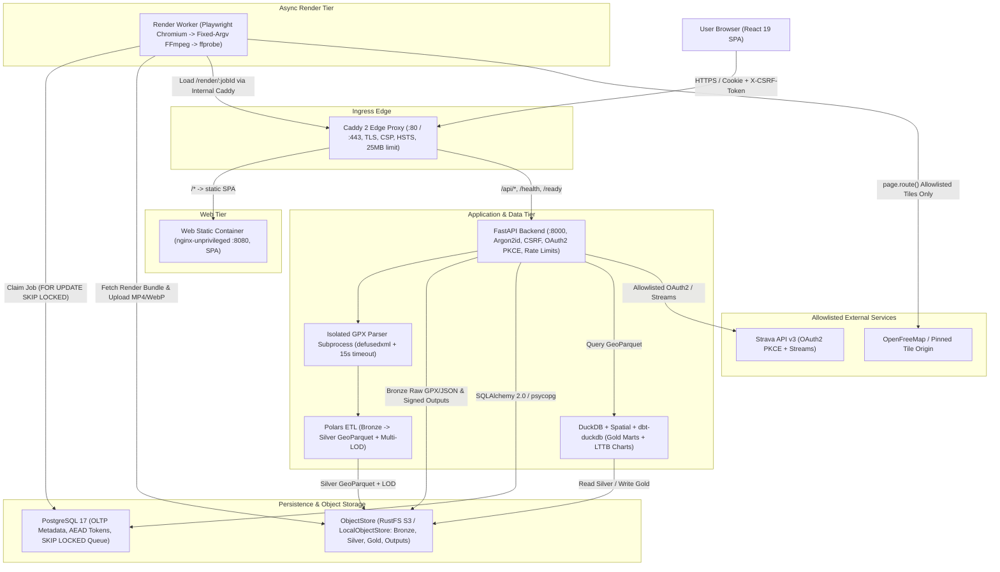
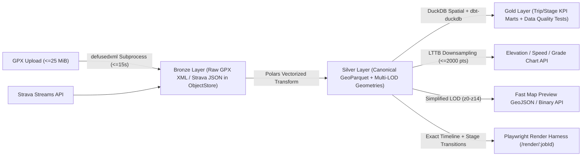

# Trip Animator — System Architecture

> Purpose: Describe the system containers, the Bronze/Silver/Gold telemetry pipeline, the render pipeline and the configuration contract.
> Audience: contributors, reviewers
> Last reviewed: 2026-11-20

Sections:

- 1. System Context & Container Architecture
- 2. Medallion Telemetry Pipeline (`Bronze -> Silver -> Gold`)
- 3. Deterministic 1:1 WYSIWYG Render Pipeline
- 4. Service & Container Topology (`infra/compose.yaml`)
- 5. Configuration Contract (`.env.example`)

Trip Animator is a security-hardened, multi-day GPS & Strava trip animation platform pairing a **React 19 + MapLibre/Deck.gl** editor with a **Python 3.12 Medallion Data Platform** (`Polars` + `GeoParquet` + `DuckDB` + `dbt-duckdb`) and a **deterministic Playwright + FFmpeg** server-side video render pipeline.

---

## 1. System Context & Container Architecture



---

## 2. Medallion Telemetry Pipeline (`Bronze -> Silver -> Gold`)

Trip Animator avoids sending massive raw coordinate arrays (e.g., 20 tracks × 500k points) to the browser or recomputing telemetry metrics ad hoc during rendering. Every imported GPX or Strava activity flows through a deterministic medallion pipeline implemented in `packages/telemetry` and `dbt/`:



### Layer Contracts
1. **Bronze (`bronze/{project_id}/{stage_id}/{digest}.{ext}` in ObjectStore)**:
   - Immutable raw bytes of uploaded `.gpx` XML files and raw Strava activity + stream JSON responses.
   - Keyed by SHA-256 content digest and project/stage identifiers for auditability and reproducible reprocessing.
2. **Silver (`silver/{project_id}/{stage_id}.parquet` in ObjectStore via `Polars` + `PyArrow`)**:
   - Normalized point telemetry table stored as Snappy/Zstd GeoParquet:
     - `trip_id`, `stage_id`, `seq`, `ts_utc`, `lat`, `lon`, `lon_unwrapped`, `elev_m`, `delta_dist_m`, `cum_dist_m`, `speed_mps`, `grade_pct`, `hr_bpm`, `cadence`, `watts`, `segment_idx`, `is_moving`, `elapsed_s`, `is_trimmed`.
   - Applies antimeridian longitude unwrapping (`unwrap_longitudes`), coordinate validity filtering (`[-90, 90]`, `[-180, 180]`), consecutive duplicate point collapsing, non-destructive trim flags (`is_trimmed`), and multi-LOD geometry simplification (`full`, `medium`, `low`) so map rendering stays responsive at 100k+ points.
3. **Gold (`dbt/` via `dbt-duckdb` + DuckDB `spatial`)**:
   - Declarative SQL models transforming Silver GeoParquet into trip and stage KPI marts (`total_distance_m`, `elevation_gain_m`, `elevation_loss_m`, `moving_seconds`, `elapsed_seconds`, `avg_moving_speed_mps`, `max_speed_mps`, `vam_m_per_h`, `max_grade_pct`, `avg_hr_bpm`, `avg_watts`).
   - Enforces dbt data quality tests (`not_null`, valid coordinate bounds, monotonic `cum_dist_m` per stage).
   - Serves low-latency LTTB-downsampled telemetry series for synchronized `uPlot` elevation/speed scrubbing in the Editor.

---

## 3. Deterministic 1:1 WYSIWYG Render Pipeline

A core architectural upgrade over v1 is eliminating preview/export divergence and redundant per-frame MapLibre rendering:

```mermaid
sequenceDiagram
    participant UI as Editor SPA
    participant API as FastAPI API
    participant PG as PostgreSQL 17
    participant W as Render Worker
    participant C as Headless Chromium (/render/:jobId)
    participant F as FFmpeg + ffprobe
    participant S as ObjectStore

    UI->>API: POST /api/v1/projects/{id}/renders (Idempotency-Key + revision)
    API->>PG: Validate spec & insert render_jobs (status=queued)
    API-->>UI: 202 Accepted (jobId)
    UI->>API: Subscribe SSE /api/v1/renders/{jobId}/events

    W->>PG: SELECT ... FOR UPDATE SKIP LOCKED (lease 120s)
    W->>C: Launch Chromium with page.route() SSRF/allowlist guard
    C->>API: Load /render/{jobId} route + Silver timeline/LOD
    loop frame = 0 .. total_frames - 1
        W->>C: window.__tripRender.seekToFrame(frame)
        alt fit-track mode (frame > 0 & camera static)
            Note over C: Reuse cached static base map canvas; update Deck.gl route + SVG/HTML HUD only
        else follow-marker or 3D camera change
            C->>C: Update camera + Deck.gl Trips/PathLayer + HUD, await map.idle
        end
        W->>C: Capture RGBA/PNG frame buffer
        W->>F: Write frame to stdin pipe
        opt Every N frames
            W->>PG: Renew job lease & update progress_pct
        end
    end
    F->>F: Encode H.264 (libx264, yuv420p, +faststart) + ffprobe verify + extract WebP thumbnail
    W->>S: Upload outputs/{jobId}.mp4 & outputs/{jobId}.webp
    W->>PG: Mark job succeeded & record audit_events
    API-->>UI: SSE event (succeeded, download & inline video URL)
```

### Key v1 Fixes Incorporated by Design
- **WYSIWYG 1:1 Parity**: Browser preview and server export share the exact same React + MapLibre GL JS v5 + Deck.gl + crisp HTML/SVG vector HUD components (`statisticsPanel` no longer uses the 5×5 pixel bitmap font missing `J/Q/X/Z/+/%,`).
- **`fit-track` Base Frame Caching**: When the camera is stationary (`fit-track` and holds), MapLibre base tiles are frozen instead of re-rendering 900+ redundant tile passes.
- **`follow-marker` Dynamic Camera**: `follow-marker` tracks an active zoom/pitch/bearing viewport around the moving marker rather than locking at full-trip `fit-track` zoom.
- **Stage & Transition Fidelity**: `showOvernightStops` is wired end-to-end; `stage_colors` and `stage_transitions` (`none`, `bed`, `meal`, `coffee`, `tent`, `transport`) validate against actual project stage IDs; 5s watermarked preview preserves proportional trail duration.

---

## 4. Service & Container Topology (`infra/compose.yaml`)

| Service | Image / Build | Port | Purpose & Runtime Hardening |
| :--- | :--- | :--- | :--- |
| `caddy` | `caddy:2-alpine` | `80`, `443` | Reverse proxy (`/api/*`, `/health` -> `api:8000`; `/*` -> `web:8080`), TLS, HSTS, strict CSP, `25MB` max upload body |
| `web` | `infra/docker/Dockerfile.web` (`nginxinc/nginx-unprivileged:alpine`) | `8080` (internal) | Serves built Vite React 19 SPA with SPA fallback; non-root UID `101`, `read_only`, `cap_drop: ALL` |
| `api` | `infra/docker/Dockerfile.api` (`python:3.12-slim` + `uv`) | `8000` (internal) | FastAPI REST/SSE API, DuckDB/Polars orchestration; non-root UID `10001`, `read_only`, `tmpfs /tmp`, `cap_drop: ALL` |
| `migrate` | `infra/docker/Dockerfile.api` | — | Runs `alembic upgrade head` against PostgreSQL before `api`/`worker` start |
| `worker` | `infra/docker/Dockerfile.worker` (`python:3.12-slim` + `uv` + Playwright + FFmpeg) | — | Polls `render_jobs` via `SKIP LOCKED`, drives `/render/:jobId`, encodes MP4; non-root UID `10001`, `read_only`, `tmpfs /tmp:size=2G`, `shm_size: 1gb`, `cap_drop: ALL` |
| `postgres` | `postgres:17.6-bookworm` | `5432` (loopback) | Primary OLTP store and lease-based render queue with `pg_isready` healthcheck |
| `minio` | `rustfs/rustfs:latest` | `9000`, `9001` (loopback) | S3-compatible Bronze/Silver/Gold/Output object storage in Compose |
| `minio-init` | `infra/docker/Dockerfile.api` (`trip-animator-v2-api:local`) | — | Idempotently provisions `S3_BUCKET` via `boto3` on startup |
| `airflow-init` | `infra/docker/Dockerfile.airflow` (`python:3.12-slim` + Airflow 3) | — | Idempotently creates dedicated `${AIRFLOW_DB:-airflow}` PostgreSQL database and runs `airflow db migrate` |
| `airflow` | `infra/docker/Dockerfile.airflow` (supervised API server, scheduler, DAG processor, and triggerer) | `8081` (loopback) | Required Strava Vault sync orchestrator; also runs `trip_dbt_gold_pipeline` and `trip_platform_maintenance_and_audit`; non-root UID `10001`, `read_only`, `cap_drop: ALL`. Library browsing and GPX import remain independent of Airflow availability. |

---

## 5. Configuration Contract (`.env.example`)

All services derive runtime configuration from the repository root `.env` contract:
- **Runtime**: `APP_ENV`, `LOG_LEVEL`, `DEV_AUTH_ENABLED`
- **Database**: `POSTGRES_DB`, `POSTGRES_USER`, `POSTGRES_PASSWORD`, `DATABASE_URL`
- **Security**: `SESSION_SECRET` (min 32 bytes), `TOKEN_ENCRYPTION_KEY` (base64 32-byte AES-256-GCM key), `ALLOWED_ORIGINS`
- **Object Storage**: `OBJECT_STORE_BACKEND` (`local` or `s3`), `LOCAL_OBJECT_STORE_DIR`, `S3_ENDPOINT_URL`, `S3_ACCESS_KEY_ID`, `S3_SECRET_ACCESS_KEY`, `S3_BUCKET`, `S3_REGION`
- **Strava OAuth2**: `STRAVA_CLIENT_ID`, `STRAVA_CLIENT_SECRET`, `STRAVA_REDIRECT_URI`
- **Rendering & Egress Allowlist**: `MAP_TILE_ALLOWLIST`, `RENDER_BASE_URL`, `WORKER_CONCURRENCY`
- **Airflow Orchestration**: `AIRFLOW_PORT`, `AIRFLOW_DB`, `AIRFLOW_FERNET_KEY`, `AIRFLOW_API_SECRET_KEY`, `AIRFLOW_JWT_SECRET`, `AIRFLOW_SIMPLE_AUTH_USERS` (`username:role` entries, default `admin:admin`), `GOLD_OUTPUT_DIR`

In Docker Compose (`infra/compose.yaml`), internal service discovery overrides host-oriented `localhost` URLs (`postgres:5432`, `http://minio:9000`, `http://caddy:80`) while preserving credential and secret injection from the root env file.
