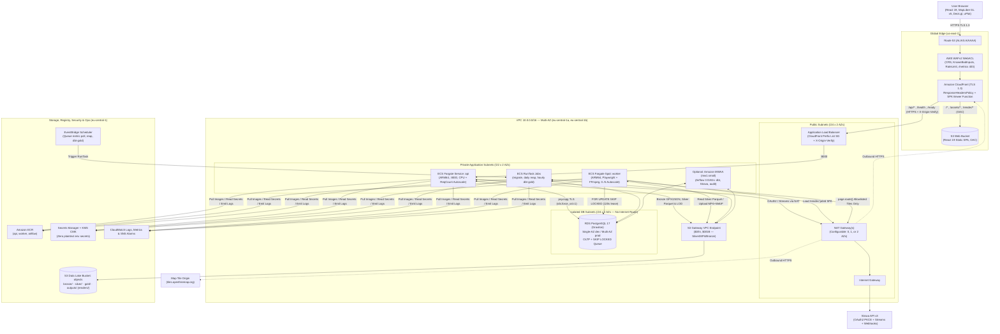

# Trip Animator — Production AWS Deployment Architecture

> Purpose: Describe the optional AWS deployment architecture that the Terraform in infra/terraform provisions.
> Audience: operators, reviewers
> Last reviewed: 2026-11-20

Sections:

- 1. Architecture Overview & Design Principles
- 2. End-to-End AWS Architecture Diagram
- 3. Edge & Ingress Tier (`CloudFront` + `WAFv2` + `S3 Web`)
- 4. VPC Networking & Zero-Egress-Waste Design
- 5. Compute, Scaling & Batch Orchestration (`ECS Fargate`)
- 6. Data, Object Storage & Secrets Architecture
- 7. Security Controls & Observability
- 8. Terraform Module & Resource Blueprint (`infra/terraform/`)

This document defines the production-grade, horizontally scalable AWS architecture for **Trip Animator** in **`eu-central-1` (Frankfurt)**, engineered for 1:1 behavioral parity with the hardened local stack (`infra/compose.yaml`, `infra/Caddyfile`, `docs/ARCHITECTURE.md`, and `docs/THREAT_MODEL.md`) while leveraging AWS managed services for high availability, zero-trust private networking, Spot render elasticity, and FinOps efficiency.

---

## 1. Architecture Overview & Design Principles

| Principle | AWS Realization |
| :--- | :--- |
| **Zero-Trust Edge & Same-Origin Parity** | Route 53 → **CloudFront** (TLS 1.3) + **AWS WAFv2** (`us-east-1`) fronts both the static React 19 SPA (**S3 `web` via OAC**) and the dynamic **FastAPI backend** (ALB → ECS Fargate), preserving same-origin session cookies (`HttpOnly`, `SameSite=Lax`, `Secure`) and `X-CSRF-Token` validation. |
| **Private Data Plane & Zero-Fee Lake I/O** | RDS PostgreSQL 17 sits in **isolated DB subnets** (`0.0.0.0/0` absent); ECS `api` and `worker` tasks sit in **private app subnets**. An **S3 Gateway VPC Endpoint** routes 100% of `bronze/`, `silver/`, `gold/`, and `outputs/` traffic over the AWS backbone at **$0/GB**, avoiding NAT Gateway data-processing charges. |
| **Elastic Scale-to-Zero Rendering** | Render workers run on **ECS Fargate Spot** (`ARM64` Graviton), scaling **`0 → N`** from a custom `TripAnimator/RenderQueueDepth` metric. PostgreSQL `FOR UPDATE SKIP LOCKED` with 120-second leases (`apps/worker/src/trip_worker/runner.py`) guarantees safe Spot interruption recovery. |
| **Defense-in-Depth & Least Privilege** | Customer-managed **AWS KMS** CMK encrypts RDS, S3, ECR, Secrets Manager, and CloudWatch Logs; zero plaintext secrets in ECS Task Definitions; strict SG-to-SG chaining; non-root UID `10001` read-only containers with `cap_drop: ["ALL"]`. |
| **Serverless Batch First, Optional MWAA** | `migrate`, `reap`, and `dbt` Gold builds default to **EventBridge Scheduler → ECS `RunTask`** (~$0.02–$1.70/mo) invoking the pure-Python `trip_api.cli` and `trip_airflow` modules, with an explicit drop-in upgrade path to **Amazon MWAA (`mw1.small`)**. |

---

## 2. End-to-End AWS Architecture Diagram



---

## 3. Edge & Ingress Tier (`CloudFront` + `WAFv2` + `S3 Web`)

### 3.1 DNS, Certificates & WAFv2 (`us-east-1`)
- **Route 53**: `A` and `AAAA` ALIAS records pointing the application domain (e.g., `trips.example.com`) to the CloudFront distribution.
- **ACM Certificates**:
  - **Edge Certificate (`us-east-1`)**: Required by CloudFront (`minimum_protocol_version = "TLSv1.2_2021"`, supporting TLS 1.3).
  - **Origin Certificate (`eu-central-1`)**: Attached to the ALB HTTPS listener (`origin.<domain>`) when custom DNS is active so CloudFront-to-ALB traffic is **end-to-end TLS** (`origin_protocol_policy = "https-only"`, `origin_ssl_protocols = ["TLSv1.2"]`). In ephemeral dev environments without a custom domain, CloudFront can target the ALB over HTTP while still enforcing `X-Origin-Verify` and CloudFront prefix-list Security Group rules.
- **AWS WAFv2 (`scope = "CLOUDFRONT"` in `us-east-1`)**:
  1. **Explicit `/metrics` Edge Block**: Custom URI path rule matching `/metrics` → `403 Forbidden` (matches `infra/Caddyfile` lines 39–41).
  2. **Rate-Based Rules**: Global IP rate limit (e.g., `2,000` requests / 5 minutes) plus a stricter rule on `/api/v1/auth/login` (`100` requests / 5 minutes per IP) backing FastAPI's persistent PostgreSQL rate limiter.
  3. **`AWSManagedRulesCommonRuleSet`**: Enabled with an explicit rule override (`Count` or scoped exclusion) on **`SizeRestrictions_BODY`** for `POST /api/v1/projects/*/stages/gpx` (multipart GPX uploads up to **25 MiB** legitimately exceed WAF's 8 KB default body inspection threshold; FastAPI enforces streaming 25 MiB caps + `defusedxml` 15-second subprocess isolation per `docs/THREAT_MODEL.md` TM-04).
  4. **`AWSManagedRulesKnownBadInputsRuleSet`**: Blocks common LFI/RFI/XXE/Log4j patterns at the edge.

### 3.2 CloudFront Routing, Caching & Security Headers

| Path Pattern | Origin | Cache Policy | Origin Request Policy | Key Behavior & Parity Notes |
| :--- | :--- | :--- | :--- | :--- |
| `/assets/*` | S3 `web` (OAC) | `CachingOptimized` (1 yr TTL) | None | Matches `infra/docker/nginx.conf` (`Cache-Control: public, immutable`). |
| `/api/*` | ALB | `CachingDisabled` | `AllViewerExceptHostHeader` | Forwards `Cookie` (`trip_session`), `X-CSRF-Token`, `Idempotency-Key`, `Content-Type`, and all HTTP methods (`GET, HEAD, OPTIONS, PUT, POST, PATCH, DELETE`). |
| `/health`, `/ready` | ALB | `CachingDisabled` | `AllViewerExceptHostHeader` | Unauthenticated liveness & DB readiness checks. |
| `/*` (Default) | S3 `web` (OAC) | Custom short/no-cache for `index.html` | None | CloudFront Function (`viewer-request`) rewrites SPA client routes (`/login`, `/strava/callback`, `/projects/*`, `/render/*`, `/share/*`) to `/index.html` without masking missing `.js`/`.css` assets under `/assets/*`. |

- **Origin Access Control (OAC)**: The `web` S3 bucket has **all 4 Public Access Block settings enabled** (`block_public_acls`, `block_public_policy`, `ignore_public_acls`, `restrict_public_buckets`) and grants `s3:GetObject` exclusively to `cloudfront.amazonaws.com` conditioned on `AWS:SourceArn`.
- **Origin Cloaking (`X-Origin-Verify`)**: CloudFront injects a secret custom header (`X-Origin-Verify`) stored in Secrets Manager. The ALB HTTPS/HTTP listener forwards `/api/*`, `/health`, `/ready` only when `X-Origin-Verify` matches, returning `403` otherwise; `/metrics` returns `403` unconditionally at the ALB listener.
- **SSE Render Progress (`/api/v1/renders/{jobId}/events`)**: Set CloudFront origin response timeout to **`60s`** (maximum standard CloudFront timeout) and ALB `idle_timeout = 120` seconds (matching `apps/api/src/trip_api/routers/renders.py`, which streams `text/event-stream` with `Cache-Control: no-cache`, `X-Accel-Buffering: no`, and polls PostgreSQL every 0.5s). Browser `EventSource` automatically reconnects on edge timeout.
- **Response Headers Policy (1:1 parity with `infra/Caddyfile`)**:
  - `Content-Security-Policy`: `default-src 'self'; script-src 'self'; style-src 'self' 'unsafe-inline'; img-src 'self' data: blob: https://tiles.openfreemap.org; font-src 'self' data: https://tiles.openfreemap.org; connect-src 'self' https://tiles.openfreemap.org; worker-src 'self' blob:; child-src 'self' blob:; media-src 'self' blob:; object-src 'none'; base-uri 'self'; form-action 'self'; frame-ancestors 'none'`
  - `Strict-Transport-Security`: `max-age=31536000; includeSubDomains`
  - `X-Content-Type-Options`: `nosniff`
  - `X-Frame-Options`: `DENY`
  - `Referrer-Policy`: `strict-origin-when-cross-origin`
  - `Permissions-Policy`: `geolocation=(), camera=(), microphone=()`

---

## 4. VPC Networking & Zero-Egress-Waste Design

### 4.1 Multi-AZ Subnet Topology (`10.0.0.0/16`)
Deployed across 2 Availability Zones (`eu-central-1a`, `eu-central-1b`; expandable to 3 AZs):

| Tier | Subnets (Example CIDRs) | Route Table Target | Hosted Resources |
| :--- | :--- | :--- | :--- |
| **`public`** | `10.0.0.0/24`, `10.0.1.0/24` | `0.0.0.0/0` → **Internet Gateway (IGW)** | ALB, NAT Gateway(s). |
| **`private_app`** | `10.0.16.0/22`, `10.0.20.0/22` | `0.0.0.0/0` → **NAT Gateway** (if enabled)<br/>`pl-xxxxxxxx` → **S3 Gateway Endpoint** | ECS `api`, ECS `worker`, `migrate`/`reap`/`dbt` RunTasks, optional MWAA. |
| **`isolated_db`** | `10.0.32.0/24`, `10.0.33.0/24` | **Local VPC (`10.0.0.0/16`) ONLY** (no IGW/NAT) | RDS PostgreSQL 17 (`db_subnet_group`). |

### 4.2 NAT Gateway & S3 Gateway VPC Endpoint Strategy
- **S3 Gateway VPC Endpoint (`com.amazonaws.eu-central-1.s3`)**: Always provisioned at **$0/hr and $0/GB** and attached to `private_app` route tables. Because `api` reads/writes Silver GeoParquet and Bronze payloads, `worker` downloads Silver Parquet and uploads MP4/WebP outputs, and `dbt` reads all Silver Parquet files, routing S3 over the Gateway Endpoint eliminates `$0.052/GB` NAT data-processing fees on all lake and video I/O.
- **NAT Gateway Modes (`enable_nat_gateway`, `single_nat_gateway`)**:
  - **`worker`** requires outbound HTTPS to `https://tiles.openfreemap.org` (`MAP_TILE_ALLOWLIST`) and `RENDER_BASE_URL` (CloudFront SPA), and **`api`** requires outbound HTTPS to `https://www.strava.com` (OAuth2/Streams) plus AWS ECR/Secrets Manager/CloudWatch APIs.
  - **Portfolio / Dev (`enable_nat_gateway = false`)**: Places ECS tasks in `public` subnets with `assign_public_ip = true` and strict ingress Security Groups (API accepts `:8000` only from `sg_alb`; Worker accepts zero inbound ports), saving **$41.61/mo** while keeping RDS in `isolated_db` subnets.
  - **Cost-Optimized Prod (`enable_nat_gateway = true`, `single_nat_gateway = true`)**: Private subnets with 1 NAT Gateway in AZ-a (**$41.61/mo** base).
  - **High-Availability Prod (`enable_nat_gateway = true`, `single_nat_gateway = false`)**: 1 NAT Gateway per AZ (**$83.22/mo** base) for full AZ-failure isolation.

### 4.3 Least-Privilege Security Group Matrix

| Security Group | Inbound Rules | Outbound Rules |
| :--- | :--- | :--- |
| **`sg_alb`** | `TCP 443` (and `TCP 80` redirect) from AWS Managed Prefix List `com.amazonaws.global.cloudfront.origin-facing` ONLY | `TCP 8000` to `sg_api` |
| **`sg_api`** | `TCP 8000` from `sg_alb` ONLY | `TCP 5432` to `sg_rds`; `TCP 443` to `0.0.0.0/0` (S3 Gateway prefix list, Strava API, ECR, Secrets Manager, Logs) |
| **`sg_worker`** | **None (0 inbound rules)** | `TCP 5432` to `sg_rds`; `TCP 443` to `0.0.0.0/0` (S3 Gateway prefix list, `MAP_TILE_ALLOWLIST`, CloudFront `RENDER_BASE_URL`, ECR, Logs) |
| **`sg_rds`** | `TCP 5432` from `sg_api`, `sg_worker`, and `sg_airflow` (when MWAA/Airflow is enabled) ONLY | None required (or VPC CIDR `5432` self if needed) |
| **`sg_airflow`** *(optional)* | Self (`sg_airflow` all TCP/UDP for MWAA internal workers) | `TCP 5432` to `sg_rds`; `TCP 443` to `0.0.0.0/0` (S3 prefix list, Strava API, Logs) |

---

## 5. Compute, Scaling & Batch Orchestration (`ECS Fargate`)

### 5.1 Docker Compose to AWS ECS Fargate Translation
Several Linux runtime flags used in `infra/compose.yaml` require Fargate-specific equivalents on AWS ECS (`Platform Version 1.4.0+`):

| Compose Setting (`infra/compose.yaml`) | ECS Fargate Equivalent | Engineering Rationale |
| :--- | :--- | :--- |
| `read_only: true` | `readonlyRootFilesystem = true` | Supported directly on Fargate; container root FS remains immutable. |
| `tmpfs: /tmp:size=256M` (`api`) / `2G` (`worker`) | **Ephemeral Volume** (`volume` with no `efs_volume_configuration` / `host_path`) mounted at `/tmp` + `ephemeral_storage { size_in_gib = 21..30 }` | ECS Fargate does **not** support `linuxParameters.tmpfs` (EC2-only). Fargate ephemeral storage is encrypted with AWS-managed AES-256 by default and provides 20 GiB free (21–30 GiB allocates sufficient headroom for 1080p/4K FFmpeg temp files and DuckDB temp spills). |
| `shm_size: "1gb"` (`worker`) | Handled by `--disable-dev-shm-usage` in `apps/worker/src/trip_worker/renderer.py` (line 38) | Fargate ignores Docker `shm_size`; `--disable-dev-shm-usage` directs Chromium shared memory to `/tmp` on ephemeral storage (`HOME=/tmp`, `XDG_CACHE_HOME=/tmp/.cache` per `Dockerfile.worker`). |
| `cap_drop: ["ALL"]` | `linuxParameters.capabilities.drop = ["ALL"]` | Supported on Fargate Linux tasks alongside non-root `USER 10001:10001`. |
| Architecture | `runtime_platform { cpu_architecture = "ARM64", operating_system_family = "LINUX" }` | Both `FARGATE` and `FARGATE_SPOT` support `ARM64` Graviton on Fargate `1.4.0+`, cutting compute cost ~20% across `api` and `worker` (build multi-arch or `linux/arm64` images in CI/ECR). |

### 5.2 ECS Services & Autoscaling

#### `api` Service (`FARGATE` On-Demand)
- **Image & Port**: ECR `trip-animator-<env>/api`, container port `8000`, `uvicorn trip_api.main:app --host 0.0.0.0 --port 8000 --proxy-headers --forwarded-allow-ips *`.
- **Sizing**:
  - Dev / Portfolio: `0.5 vCPU / 1 GiB` (or `1 vCPU / 2 GiB` for large 25 MiB GPX ingestion + Polars/DuckDB).
  - Early SaaS: `1 vCPU / 2 GiB` (`desired = 2` across 2 AZs).
  - Growth / High Load: `2 vCPU / 4 GiB` (`min = 2`, `max = 8`).
- **Health Checks & Rollouts**:
  - ALB Target Group health check: `GET /health` (`interval = 15s`, `timeout = 5s`, `healthy_threshold = 2`, `unhealthy_threshold = 3`, `deregistration_delay = 30s`). Using `/health` prevents cascading API fleet restarts during brief RDS failovers, while ECS container `healthCheck` or CI smoke checks probe `/ready` (`SELECT 1` on PostgreSQL).
  - Deployment Circuit Breaker enabled with automatic rollback (`minimum_healthy_percent = 100`, `maximum_percent = 200`).
- **Autoscaling**: Application Auto Scaling Target Tracking:
  - `ECSServiceAverageCPUUtilization`: target **`65%`** (`scale_in_cooldown = 300s`, `scale_out_cooldown = 60s`).
  - `ALBRequestCountPerTarget`: target **`1,000`** requests/target/min.

#### `worker` Service (`FARGATE_SPOT`, Scale-to-Zero `0..N`)
- **Image & Sizing**: ECR `trip-animator-<env>/worker`, `2 vCPU / 4 GiB` ARM64 (`4 vCPU / 8 GiB` under Growth load for faster SwiftShader WebGL + `libx264` encoding), `ephemeralStorage = 30 GiB`, `WORKER_CONCURRENCY = 1`, `RENDER_BASE_URL = https://<domain>` (CloudFront SPA `/render/:jobId`), `MAP_TILE_ALLOWLIST = https://tiles.openfreemap.org`.
- **Spot Resilience**: `runner.py` handles `SIGTERM` gracefully (stopping new claims) and uses a PostgreSQL `FOR UPDATE SKIP LOCKED` lease (`lease_seconds = 120`, `max_attempts = 3`, heartbeat every `5` frames). If AWS reclaims a Spot task with 2 minutes' notice, any unfinished job's lease expires and is re-claimed cleanly by a replacement task. In Growth tier, optionally configure capacity provider strategy `FARGATE_SPOT` (weight `4`) + `FARGATE` (weight `1`) to prevent queue stalls during regional Spot capacity dips.
- **Autoscaling `0..N` on `render_jobs` Queue Depth**:
  1. A lightweight **EventBridge Scheduler (1-minute cadence) → Lambda** (or internal `/metrics` collector with `METRICS_TOKEN`) queries PostgreSQL (`SELECT COUNT(*) FROM render_jobs WHERE status IN ('queued', 'running')`) and publishes custom metric **`TripAnimator/RenderQueueDepth`** (`ActiveRenderJobs`) to CloudWatch.
  2. **ECS Step Scaling Policy**:
     - `ActiveRenderJobs >= 1`: scale out immediately (`+1` task for 1–2 jobs, `+2` tasks for 3–5 jobs, capped at `max_capacity`).
     - `ActiveRenderJobs == 0` for `15` consecutive 1-minute periods (`cooldown = 300s`): scale in to **`0`** (`min_capacity = 0`).
  3. Because the metric counts both `queued` and `running` jobs, active renders keep `desired_count >= 1` until encoding finishes and artifacts are uploaded to S3.

### 5.3 Migrations, Retention Reaper & `dbt` Gold Orchestration
1. **Schema Migrations (`migrate` ECS `RunTask`)**:
   - Uses `trip-animator-<env>/api` image with `workingDirectory = "/app/apps/api"` and `command = ["alembic", "upgrade", "head"]`.
   - Executed synchronously in CI/CD before updating ECS `api`/`worker` services.
2. **Retention Reaper (`reap` Scheduled ECS `RunTask`)**:
   - **EventBridge Scheduler** (`cron(0 3 * * ? *)`, daily 03:00 UTC) launches `trip-animator-<env>/api` on `FARGATE_SPOT` with `command = ["python", "-m", "trip_api.cli", "reap", "--json"]`.
   - Prunes expired `sessions`, `oauth_states`, stale `rate_limits`, and expired `render_jobs` rows alongside their S3 `outputs/{jobId}.mp4` & `.webp` artifacts past `RENDER_RETENTION_DAYS` (default `7`).
3. **Gold Analytics & Incremental Sync (`dbt-gold` / `strava-sync`)**:
   - Because `dbt-duckdb` is packaged in `airflow/pyproject.toml` (`Dockerfile.airflow`) rather than `Dockerfile.api`, scheduled data-engineering tasks run using the **`trip-animator-<env>/airflow`** ECR image:
     - **Default Serverless Pattern (Scenarios 1–3)**: EventBridge Scheduler triggers `ecs:RunTask` on `FARGATE_SPOT` invoking `trip_airflow.dbt_gold.materialize_gold_marts` + `validate_gold_marts` (hourly, pushing `trip_analytics.duckdb` / Gold Parquet outputs to `s3://<objects_bucket>/gold/`), `trip_airflow.maintenance_audit` (daily reconciliation + Silver GeoParquet schema audit), and `trip_airflow.strava_sync` (every 30 minutes).
     - **Optional Managed Orchestration (Scenario 4 — Amazon MWAA `mw1.small`)**: Syncs `airflow/dags/` (`trip_dbt_gold_pipeline.py`, `trip_strava_incremental_sync.py`, `trip_platform_maintenance_and_audit.py`) to an MWAA S3 bucket, connecting MWAA's private subnets to RDS PostgreSQL 17 and S3 `objects` via the S3 Gateway Endpoint.

---

## 6. Data, Object Storage & Secrets Architecture

### 6.1 Amazon RDS for PostgreSQL 17
- **Engine**: PostgreSQL 17 (`postgres` engine, Graviton2 `db.t4g.micro` / `db.t4g.small` / `db.r6g.large`).
- **Storage & Encryption**: `gp3` SSD, `storage_encrypted = true` with customer-managed KMS CMK, `storage_autoscaling` enabled (`max_allocated_storage`).
- **In-Transit TLS**: Custom `aws_db_parameter_group` (`family = "postgres17"`) enforcing **`rds.force_ssl = 1`**. Application `DATABASE_URL` appends `?sslmode=require` (or `sslmode=verify-full` with AWS RDS global bundle).
- **Availability & Backups**:
  - Dev / Scenario 1: `multi_az = false`, `backup_retention_period = 7`, `deletion_protection = false`.
  - Prod / Scenarios 2–4: `multi_az = true`, `backup_retention_period = 14` (or `30`), `deletion_protection = true`, `skip_final_snapshot = false`, Performance Insights enabled on `db.r6g.*` / `db.t4g.medium+` (note: `db.t4g.micro` and `db.t4g.small` do not support Performance Insights).
- **Connection Pooling**: `api` uses SQLAlchemy's pool (`pool_size=5, max_overflow=10` = max 15 conns/task) and `worker` opens short-lived `psycopg` connections per job/heartbeat (`runner.py`). Under Scenario 3 (`max 8 API tasks` = ~120 conns + workers), `db.r6g.large` (`~1,700` max connections) provides >10x headroom; above ~20 API tasks, introduce **Amazon RDS Proxy**.

### 6.2 S3 Data Lake (`objects` Bucket) & Lifecycle Rules
Single encrypted bucket `trip-animator-<env>-objects` (Public Access Block: all 4 `true`, SSE-KMS with S3 Bucket Key enabled, bucket policy denying `aws:SecureTransport == false`):

| Prefix | Producer / Consumer | Contents | Lifecycle Policy |
| :--- | :--- | :--- | :--- |
| **`bronze/{project_id}/{stage_id}/{digest}.{ext}`** | `api` (`services.py`), `strava_sync.py` | Immutable raw `.gpx` XML (<=25 MiB) & Strava activity/stream JSON | Transition to **`STANDARD_IA`** at **30 days**; retain indefinitely for reprocessing & audit. |
| **`silver/{project_id}/{stage_id}.parquet`** & **`.lod.json.gz`** | `api` (`services.py`), `worker`, `dbt_gold.py` | Canonical Zstd/Snappy GeoParquet + gzipped multi-LOD geometry cache | Keep in **`STANDARD`** (low-latency DuckDB/LOD reads; optional Intelligent-Tiering at scale). |
| **`gold/`** | `dbt-gold` RunTask / MWAA | `trip_analytics.duckdb` snapshots & exported Parquet KPI marts | Retain or transition older snapshots to `STANDARD_IA` at 30 days. |
| **`outputs/{job_id}.mp4` & `.webp`** *(and **`renders/`**)* | `worker` (`runner.py`), `api` (`renders.py`, `share.py`), `reap` | Rendered H.264 MP4 videos & WebP thumbnails | **Expire at `RENDER_RETENTION_DAYS`** (default **`7` days**) matching `apps/api/src/trip_api/reaper.py`; abort incomplete multipart uploads after **1 day**. |

> **Codebase Key Prefix Alignment Note**: `apps/worker/src/trip_worker/runner.py` (L444–445) and `airflow/src/trip_airflow/maintenance_audit.py` (L133) currently write and reconcile rendered videos under **`outputs/`**. Provisioning the S3 Lifecycle expiration rule on **both `outputs/` and `renders/`** ensures immediate enforcement today and forward compatibility.

### 6.3 Amazon ECR, Secrets Manager & KMS
- **ECR Repositories**: `trip-animator-<env>/api`, `trip-animator-<env>/worker`, `trip-animator-<env>/airflow` with `image_tag_mutability = "IMMUTABLE"` (prod), `scan_on_push = true`, KMS encryption, and lifecycle policy keeping the latest 10 tagged images and expiring untagged layers after 7 days.
- **Customer-Managed KMS Key (`alias/trip-animator-<env>`)**: `enable_key_rotation = true`. Policy grants CloudWatch Logs (`logs.<region>.amazonaws.com` scoped by `aws:SourceAccount`) and CloudFront OAC (`cloudfront.amazonaws.com` scoped by `aws:SourceAccount`) decryption/encryption permissions without circular Terraform dependencies.
- **Secrets Manager (Zero Plaintext Secrets in Task Definitions)**:
  - `trip-animator/<env>/db-credentials`: `username`, `password`, `dbname`, `host`, `port`, `DATABASE_URL` (`postgresql+psycopg://...`).
  - `trip-animator/<env>/app-secrets`: `SESSION_SECRET` (>= 32 bytes), `TOKEN_ENCRYPTION_KEY` (32-byte URL-safe base64 AES-256-GCM key), `METRICS_TOKEN`, `STRAVA_CLIENT_ID`, `STRAVA_CLIENT_SECRET`, `STRAVA_VERIFY_TOKEN`, `ORIGIN_VERIFY_SECRET`.
  - **Codebase Integration Note for IAM Task Roles (`config.py` & `storage.py`)**:
    In the current codebase, `apps/api/src/trip_api/config.py` (L144–147) raises `ValueError` in `APP_ENV=production` if `S3_ACCESS_KEY_ID` or `S3_SECRET_ACCESS_KEY` is empty, and `S3ObjectStore` (`apps/api/src/trip_api/storage.py` L72–78; `apps/worker/src/trip_worker/storage.py` L74–80) passes `endpoint_url` directly to `boto3.client("s3", ...)`. When deploying on ECS:
    1. **Target AWS-Native Configuration (Recommended 4-line app patch)**: Allow empty `S3_ACCESS_KEY_ID`/`S3_SECRET_ACCESS_KEY` when running on IAM Role environments (`endpoint_url=endpoint_url or None`) so `boto3` automatically resolves short-lived STS credentials from the **ECS Task IAM Role** with zero static IAM keys.
    2. **Unmodified Code Compatibility**: Set `S3_ENDPOINT_URL=https://s3.eu-central-1.amazonaws.com` (non-empty) and supply a dedicated scoped Secrets Manager secret (`S3_ACCESS_KEY_ID` / `S3_SECRET_ACCESS_KEY`) injected via ECS `secrets` `valueFrom` — never stored in Terraform state or plaintext task definitions.

---

## 7. Security Controls & Observability

### 7.1 Least-Privilege IAM Role Matrix

| IAM Role | Trusted Principal | Allowed Actions & Scoped Resources |
| :--- | :--- | :--- |
| **`ecs_execution_role`** | `ecs-tasks.amazonaws.com` | `ecr:GetAuthorizationToken`, `ecr:BatchGetImage`/`GetDownloadUrlForLayer` (3 repo ARNs), `secretsmanager:GetSecretValue` (2 secret ARNs only), `kms:Decrypt` (CMK ARN), `logs:CreateLogStream`/`PutLogEvents` (scoped log group ARNs). |
| **`api_task_role`** | `ecs-tasks.amazonaws.com` | `s3:ListBucket` on `objects` bucket (`bronze/*`, `silver/*`, `outputs/*`, `renders/*`); `s3:GetObject`, `s3:PutObject`, `s3:DeleteObject` on `objects/*`; `kms:Decrypt`/`GenerateDataKey*` on CMK. |
| **`worker_task_role`** | `ecs-tasks.amazonaws.com` | `s3:GetObject` on `objects/silver/*` (and `bronze/*`); `s3:PutObject`, `s3:DeleteObject` on `objects/outputs/*` and `objects/renders/*`; `kms:Decrypt`/`GenerateDataKey*` on CMK. |
| **`batch_task_role`** | `ecs-tasks.amazonaws.com` | `reap`: `s3:DeleteObject`/`ListBucket` on `outputs/*`, `renders/*`; `dbt`: `s3:ListBucket`/`GetObject` on `silver/*` + `s3:PutObject` on `gold/*`; `kms:Decrypt`/`GenerateDataKey*`. |
| **`scheduler_role`** | `scheduler.amazonaws.com` | `ecs:RunTask` on `reap` & `dbt` Task Definition ARNs; `iam:PassRole` strictly on `ecs_execution_role` & `batch_task_role`. |

### 7.2 Observability, Metrics & Alerting
- **CloudWatch Log Groups**: `/ecs/trip-animator-<env>/{api,worker,migrate,reap,dbt}` and `/aws/wafv2/trip-animator-<env>`, KMS-encrypted, `14`-day retention (dev) / `30–90`-day retention (prod).
- **Internal `/metrics` Collection**: `/metrics` returns `403` at WAFv2, CloudFront, and ALB. Internally, an optional AWS Distro for OpenTelemetry (ADOT) sidecar or VPC Prometheus scraper queries `http://api:8000/metrics` with `Authorization: Bearer <METRICS_TOKEN>`, collecting `trip_api_up`, `trip_db_up`, `trip_render_jobs_total{status}`, `trip_projects_total`, `trip_stages_total`, `trip_sessions_active`, and `trip_oauth_connections_total` without PII.
- **CloudWatch Alarms → SNS Ops Topic**:
  - ALB `HTTPCode_Target_5XX_Count > 5` (5 min) and `UnHealthyHostCount >= 1`
  - ALB `TargetResponseTime` p95 `> 2.0s`
  - ECS `api` CPU `> 85%` or Memory `> 85%` for 10 min
  - RDS `CPUUtilization > 80%`, `FreeStorageSpace < 20%`, `DatabaseConnections > 80% max`
  - Custom `TripAnimator/RenderQueueDepth` (`QueuedJobs > 10` for 15 min → stalled/throttled Spot workers)
  - EventBridge Rule on `ECS Task State Change` (`lastStatus == STOPPED`, `exitCode != 0`) for `migrate`, `reap`, and `dbt-gold` tasks
  - AWS Budgets alert at 80% and 100% of monthly scenario budget.

---

## 8. Terraform Module & Resource Blueprint (`infra/terraform/`)

The Terraform implementation under `infra/terraform/` (`terraform >= 1.6`, `aws ~> 5.0`) maps 1:1 to this architecture across four composable modules and two environment roots:

```text
infra/terraform/
├── modules/
│   ├── networking/   # VPC, 2-AZ public/private/isolated subnets, IGW, NAT GW, S3 Gateway Endpoint, SGs
│   ├── storage/      # KMS CMK, S3 web + objects buckets, lifecycle rules, WAFv2 (us-east-1), CloudFront + OAC
│   ├── database/     # RDS PostgreSQL 17 (Graviton), force_ssl param group, Secrets Manager DB secret
│   └── compute/      # ECR repos, ECS cluster (Fargate + Spot), ALB, api/worker/migrate/reap/dbt, IAM, CW Logs
└── environments/
    ├── dev/          # Portfolio / Dev defaults (db.t4g.micro, Single-AZ, scale-to-zero worker, optional NAT)
    └── prod/         # Production defaults (Multi-AZ db.t4g.small/r6g.large, 2+ API tasks, Spot workers)
```

### Module Interfaces & Acyclic Dependency Graph
To prevent circular dependencies between `storage` (CloudFront needs `alb_dns_name`) and `compute` (ECS IAM policies need `objects_bucket_arn` and `kms_key_arn`), `environments/{dev,prod}/main.tf` orchestrates a clean DAG:
1. **`networking`** → outputs `vpc_id`, `public_subnet_ids`, `private_app_subnet_ids`, `isolated_db_subnet_ids`, `alb_security_group_id`, `api_security_group_id`, `worker_security_group_id`, `rds_security_group_id`.
2. **`database`** (depends on `networking`) → outputs `db_endpoint`, `db_port`, `db_name`, `db_secret_arn`, `kms_key_arn` (or receives shared `kms_key_arn` created at root).
3. **`compute`** (depends on `networking`, `database`, and deterministic `objects_bucket_name` string `local.objects_bucket_name`) → outputs `alb_dns_name`, `alb_arn`, `alb_zone_id`, `origin_verify_secret_arn`, `ecs_cluster_arn`, `api_service_name`, `worker_service_name`, ECR repo URLs.
4. **`storage`** (depends on `compute.alb_dns_name`, `providers = { aws = aws, aws.us_east_1 = aws.us_east_1 }`) → provisions S3 `web` + `objects` buckets, lifecycle rules (`bronze/` IA 30d, `outputs/` + `renders/` expire `render_retention_days`), CloudFront + OAC, and `us-east-1` WAFv2 WebACL.
