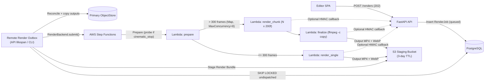

# Remote Render Backend & AWS Step Functions Lambda Execution

> Purpose: Specify the pluggable Render Backend abstraction, Transactional Outbox dispatch, Render Bundle contract, and the classic AWS Lambda + Step Functions Map parallel execution backend.
> Audience: contributors, operators, reviewers.
> Last reviewed: 2026-11-26.

Sections:

- Problem Statement
- Solution Overview
- Domain Vocabulary
- Architecture & Pluggable Abstraction
- Data Model & Transactional Outbox
- Render Bundle & Output Transfer
- AWS Step Functions + Classic Lambda Execution
- Progress, Callbacks, Reconciliation & Cancellation
- Configuration Contract (`.env`)
- Security Controls
- Standalone AWS Terraform Deployment
- Testing Seams
- Phase 0 AWS PoC Checklist
- Out of Scope

## Problem Statement

Running headless Playwright Chromium + FFmpeg on a low-resource self-hosted VPS saturates CPU and memory during 1080p or multi-stage exports, turning a 60-second film into a 15-25 minute render while competing with the web application and API. At the same time, always-on cloud GPU servers or AWS Lambda Managed Instances with GPU incur high idle costs, multi-minute cold starts from scale-to-zero, or fixed VPC/NAT Gateway overhead that does not match sporadic interactive export traffic.

## Solution Overview

Introduce a clean, pluggable **Render Backend** abstraction controlled by a single `.env` switch (`RENDER_BACKEND`), defaulting to `local` for complete backwards compatibility. Implement `aws_sfn_lambda` as the first remote backend: classic AWS Lambda containers (10 GB RAM / 6 vCPU with Mesa Lavapipe software Vulkan WebGL2, zero VPC/NAT) orchestrated by an AWS Step Functions `Map` state machine that renders chunks in parallel and concatenates them losslessly with `ffmpeg -c copy`.

The control plane (FastAPI API + PostgreSQL + primary `ObjectStore`) remains decoupled from the remote compute layer through a self-contained **Render Bundle** staged in a dedicated S3 bucket, an embedded Transactional Outbox dispatcher/reconciler inside the API lifespan, and optional HMAC-signed progress/completion callbacks. Swapping in future experimental backends (such as AWS LMI GPU, AWS Batch Spot, Modal, or Cloud Run GPU) requires implementing only one narrow `RenderBackend` protocol.

## Domain Vocabulary

Canonical terms are maintained in [GLOSSARY.md](../../GLOSSARY.md#render-execution):

- **Render Backend**: Pluggable execution target (`local` or `aws_sfn_lambda`) responsible for turning a queued render job into an output MP4 and WebP thumbnail. Distinct from `WORKER_GPU_ENABLED`, which controls local worker hardware WebGL2 acceleration only.
- **Render Bundle**: Immutable, self-contained package containing the serialized `RenderManifest` JSON and enabled photo assets staged for a remote backend.
- **Remote Execution**: Backend-managed run (e.g., an AWS Step Functions execution ARN) tracked against a `RenderJob` via an opaque reference.

## Architecture & Pluggable Abstraction

### Pluggable `RenderBackend` Protocol

All remote render backends implement a narrow protocol independent of AWS:

- `name: str` — backend identifier persisted on `RenderJob.render_backend`.
- `submit(request: RemoteSubmitRequest) -> RemoteExecutionRef` — stages the `RenderBundle` and starts a `Remote Execution`, returning an opaque reference.
- `get_status(execution_ref: str) -> RemoteExecutionStatus` — polls backend state (`queued`, `running`, `succeeded`, `failed`, `cancelled`), optional progress, output keys, and sanitized error message.
- `cancel(execution_ref: str) -> None` — requests cooperative/best-effort termination of the remote execution.
- `download_output(execution_ref: str, key: str, dest: Path) -> None` — fetches a completed output artifact from remote staging.
- `cleanup_staging(job_id: uuid.UUID) -> None` — best-effort cleanup of staging objects after completion, failure, or cancellation.

A `LocalRenderBackend` (`name = "local"`) acts as a no-op stub: jobs with `render_backend = "local"` are left `queued` for the existing PostgreSQL `SKIP LOCKED` local worker.

### Shared Package Boundary

The pure, Playwright-free `RenderManifest` and `RenderBundle` schemas and builder (`build_render_manifest`, `compute_frame_render_spans`, `photo_asset_key`, `load_photo_asset`, `chunk_manifest_key`) live in `packages/telemetry` so both `apps/api` and `apps/worker` share one canonical contract without pulling Playwright into the API container image. `apps/worker/src/trip_worker/manifest.py` re-exports all existing symbols for full compatibility.

## Data Model & Transactional Outbox

### `render_jobs` Schema Additions (Alembic Migration `0013`)

Add three columns to `render_jobs`:

- `render_backend` (`VARCHAR(32)`, `NOT NULL`, server default `'local'`, indexed): records which backend owns the job so local workers never claim remote jobs (`WHERE render_backend = 'local'`) and switching `.env` mid-flight never strands existing jobs.
- `external_execution_id` (`VARCHAR(512)`, `NULL`): opaque reference returned by `RenderBackend.submit()` (e.g., Step Functions execution ARN).
- `remote_dispatched_at` (`TIMESTAMPTZ`, `NULL`): timestamp when the job was handed off to the remote backend.

### Outbox Dispatch & Reconciliation Loop

- `POST /api/v1/projects/{project_id}/renders` inserts `RenderJob(status='queued', render_backend=settings.render_backend)` and returns `202 Accepted` immediately without holding DB locks across Parquet/S3/AWS I/O.
- When `RENDER_BACKEND != "local"`, the API lifespan starts a lightweight background asyncio loop (also runnable standalone via `python -m trip_api.cli process-remote-renders [--loop]`).
- Each iteration runs two idempotent passes using `asyncio.to_thread`:
  1. **Dispatch pass**: Claims queued remote jobs where `render_backend != 'local'` and `external_execution_id IS NULL` (using `FOR UPDATE SKIP LOCKED` on PostgreSQL, setting a short dispatch lease), loads project stages/photos and builds the `RenderBundle` outside any DB lock, calls `backend.submit()`, persists `external_execution_id`, transitions status to `running`, and emits `pg_notify('render_job_events', ...)`. Transient submission errors respect `max_attempts` and fail cleanly when exhausted.
  2. **Reconcile pass**: Scans active remote jobs (`status = 'running'`, `render_backend != 'local'`, `external_execution_id IS NOT NULL`), queries `backend.get_status()`, updates progress, ingests final outputs on `succeeded` (copying back to primary `ObjectStore` and marking the job `succeeded`), or marks `failed`/`cancelled` on terminal remote failure, emitting `pg_notify` on state changes.

## Render Bundle & Output Transfer

- Staging layout in `RENDER_AWS_STAGING_BUCKET` under `staging/{job_id}/`:
  - `staging/{job_id}/manifest.json` — serialized `RenderManifest` with `asset_url = "https://render-assets.local/{photo_id}"` (never inline base64 data URIs).
  - `staging/{job_id}/photos/{photo_id}.bin` — raw bytes of each enabled photo rendition required by the manifest.
  - `staging/{job_id}/chunks/chunk_{index:04d}.mp4` — GOP-aligned intermediate chunk MP4s produced by parallel Lambdas.
  - `staging/{job_id}/output.mp4` and `staging/{job_id}/output.webp` — final verified MP4 and thumbnail.
- Upon remote completion, the control plane copies `output.mp4` and `output.webp` into the primary `ObjectStore` (`outputs/{job_id}.mp4`, `outputs/{job_id}.webp`), verifies completion atomically against `status != 'cancelled'`, updates `render_jobs`, records an audit event, and deletes the staging prefix best-effort. When `OBJECT_STORE_BACKEND=s3` already points to the exact same AWS bucket and region, direct S3 server-side copy is used.
- The S3 staging bucket enforces a 3-day expiration lifecycle rule and aborts incomplete multipart uploads after 1 day as a safety net.

## AWS Step Functions + Classic Lambda Execution

### Single Self-Contained Lambda Container Image

A dedicated multi-stage Dockerfile (`infra/docker/Dockerfile.worker-aws-lambda`) builds:

1. Frontend stage (`node:24-slim` + `pnpm`): builds `apps/web/dist`.
2. Worker runtime stage (`python:3.12-slim` + `uv` + `ffmpeg` + `mesa-vulkan-drivers` + Playwright Chromium + `awslambdaric`): installs `trip-worker` and copies `apps/web/dist` into `/app/web-dist`.
3. Runtime entrypoint: `python -m awslambdaric trip_worker.lambda_handler.handler`.

Inside Lambda, an ephemeral stdlib HTTP server binds `127.0.0.1:0` and serves `/app/web-dist` (SPA fallback to `index.html`) as `RENDER_BASE_URL`, eliminating internet round-trips to the VPS for SPA assets, preventing deploy version skew, and preserving `ssrf.py` origin and private-IP protections unchanged. Chromium runs with `WORKER_GPU_ENABLED=false`, `WORKER_CPU_RENDERER=lavapipe`, `CHROMIUM_NO_SANDBOX=true`, and `--disable-dev-shm-usage`.

### Step Functions State Machine (`Prepare -> SingleOrMap -> Finalize`)

One Lambda function handles four actions selected by `event["action"]`:

1. **`prepare`**: Downloads `staging/{job_id}/manifest.json`. If `photo_card_style == "cinematic_stop"` and photos exist, probes Chromium (`probe_manifest_frame_count`) to obtain exact `total_frames` and writes the updated manifest back to S3. Computes `mode`:
   - `total_frames <= chunk_threshold_frames` (default `300`): returns `mode = "single"`.
   - `total_frames > chunk_threshold_frames`: returns `mode = "chunked"` and `chunks = [{chunk_index, start_frame, end_frame, preroll_frames}, ...]` with default `chunk_size_frames = 200` and `preroll_frames = 15`.
2. **`render_single`**: Renders `[0, total_frames)` directly to `/tmp`, runs `verify_mp4_output` + `extract_thumbnail`, uploads `staging/{job_id}/output.mp4` and `output.webp`, and sends a signed completion callback (if configured).
3. **`render_chunk`**: Renders `[start_frame, end_frame)` with `preroll_frames` and `gop_aligned=True`, uploads `staging/{job_id}/chunks/chunk_{index:04d}.mp4`, and sends a signed chunk-progress callback (if configured). Step Functions `Map` runs with `MaxConcurrency = 8` (configurable) and built-in retry on transient errors.
4. **`finalize`**: Downloads all `chunk_*.mp4` files from S3, runs `concat_mp4_chunks` (`ffmpeg -c copy`), `verify_mp4_output`, and `extract_thumbnail`, uploads `staging/{job_id}/output.mp4` and `output.webp`, and sends a signed completion callback (if configured).

A Step Functions `Catch` block transitions any unhandled failure to a `report_failure` Lambda invocation that posts a sanitized failure callback (if configured) before failing the execution.

## Progress, Callbacks, Reconciliation & Cancellation

### Signed HMAC Callback Endpoint

- Route: `POST /api/v1/internal/render-callbacks` (exempt from session cookie / CSRF auth; authenticated exclusively by HMAC-SHA256).
- Headers:
  - `X-Trip-Signature`: `sha256=<hex>` computed over `f"{timestamp}.{raw_body}"` using `RENDER_CALLBACK_SECRET`.
  - `X-Trip-Timestamp`: Unix epoch seconds; rejected if outside `±300s` replay window.
- Constant-time comparison (`hmac.compare_digest`). Disabled (returns `404` / `503`) whenever `RENDER_CALLBACK_SECRET` is empty.
- Payload events: `running` (with `progress_pct` or `chunk_done` / `total_chunks`), `succeeded` (with `output_key`, `thumbnail_key`, `probe`), `failed` (with sanitized `error_message`).
- Idempotency & terminal safety: callbacks never overwrite terminal states (`succeeded`, `failed`, `cancelled`) and never regress `progress_pct`. On `succeeded`, the callback triggers immediate output ingestion into the primary `ObjectStore` (or schedules it safely outside DB locks).

### Cancellation

- `POST /api/v1/renders/{job_id}/cancel` marks `RenderJob.status = 'cancelled'`, emits `pg_notify`, commits, and when `external_execution_id` is set calls `backend.cancel(external_execution_id)` best-effort (`sfn:StopExecution`).
- Any in-flight callback arriving after cancellation is ignored and triggers best-effort staging cleanup.

## Configuration Contract (`.env`)

All new variables are optional and default to preserving current local behavior:

| Variable | Default | Purpose |
| :--- | :--- | :--- |
| `RENDER_BACKEND` | `local` | Active Render Backend (`local` or `aws_sfn_lambda`). |
| `RENDER_AWS_REGION` | `eu-central-1` | AWS region for Step Functions and staging S3. |
| `RENDER_AWS_STATE_MACHINE_ARN` | `` | ARN of the Step Functions state machine (required when `RENDER_BACKEND=aws_sfn_lambda`). |
| `RENDER_AWS_STAGING_BUCKET` | `` | S3 bucket name for Render Bundles and outputs (required when `RENDER_BACKEND=aws_sfn_lambda`). |
| `RENDER_AWS_ACCESS_KEY_ID` | `` | Optional AWS access key for remote dispatch (omit when using IAM role). |
| `RENDER_AWS_SECRET_ACCESS_KEY` | `` | Optional AWS secret key for remote dispatch (omit when using IAM role). |
| `RENDER_AWS_ENDPOINT_URL` | `` | Optional custom endpoint URL for local testing (e.g., LocalStack/Moto). |
| `RENDER_CALLBACK_BASE_URL` | `` | Optional public HTTPS base URL for signed Lambda callbacks; omit on `localhost` to rely on polling reconciliation. |
| `RENDER_CALLBACK_SECRET` | `` | Shared HMAC-SHA256 secret (>= 32 chars in production when `RENDER_CALLBACK_BASE_URL` is set). |
| `RENDER_REMOTE_CHUNK_THRESHOLD_FRAMES` | `300` | Maximum frames rendered in a single Lambda before fan-out. |
| `RENDER_REMOTE_CHUNK_SIZE_FRAMES` | `200` | Target frame count per parallel chunk Lambda. |
| `RENDER_REMOTE_PREROLL_FRAMES` | `15` | Silent preroll settle frames per non-zero chunk. |
| `RENDER_REMOTE_DISPATCH_INTERVAL_S` | `2.0` | Poll interval for outbox dispatch and reconciliation loop. |
| `RENDER_REMOTE_MAX_ATTEMPTS` | `3` | Maximum outbox dispatch attempts before failing a remote job. |

Fail-closed production validation (`APP_ENV=production`):
- When `RENDER_BACKEND=aws_sfn_lambda`, startup refuses empty `RENDER_AWS_STATE_MACHINE_ARN` or `RENDER_AWS_STAGING_BUCKET`, refuses asymmetric AWS key pairs, and requires `RENDER_CALLBACK_SECRET` (>= 32 chars) whenever `RENDER_CALLBACK_BASE_URL` is non-empty.

## Security Controls

- **Zero exposed VPS internals**: Remote Lambdas never receive `DATABASE_URL`, primary MinIO credentials, or user session/Strava secrets.
- **SSRF preservation**: Lambda Chromium runs through the exact `make_ssrf_route_handler` + IP-pinned `httpx` proxy with `render_origin = http://127.0.0.1:<ephemeral_port>` and explicit `MAP_TILE_ALLOWLIST`, blocking `169.254.169.254`, private CIDRs, and unapproved domains.
- **Signed callbacks**: HMAC-SHA256 over timestamp + raw payload with 300s replay tolerance and constant-time comparison; callback endpoint accepts no arbitrary object keys outside `staging/{job_id}/`.
- **Least-privilege IAM**: Standalone Terraform grants Lambda access strictly to the staging bucket prefix and CloudWatch Logs, Step Functions strictly to `lambda:InvokeFunction` on the single worker function, and the VPS dispatcher policy strictly to `states:StartExecution`, `states:DescribeExecution`, `states:StopExecution` on the state machine plus scoped staging S3 read/write/delete.

## Standalone AWS Terraform Deployment

Create a self-contained root configuration under `infra/terraform/standalone-remote-render/` that deploys **only** the remote render worker with zero VPC, NAT Gateway, RDS, ALB, or ECS resources:

- Encrypted ECR repository (`trip-animator-remote-render`) with lifecycle retention policy.
- Private KMS/AES256 S3 staging bucket with `PublicAccessBlock`, TLS-only policy, 3-day object expiration, and 1-day incomplete multipart abort.
- Classic AWS Lambda function (container image, 10,240 MB RAM / 6 vCPU, 900s timeout, 4,096 MB `/tmp`, non-VPC, `reserved_concurrent_executions` optional).
- AWS Step Functions Standard State Machine (`Prepare -> SingleOrMap(MaxConcurrency=8) -> Finalize`, with `Catch -> ReportFailure`).
- Scoped IAM roles for Lambda, Step Functions, and an optional IAM policy output for the VPS dispatcher credentials.

## Testing Seams

Following TDD at the highest stable public seams:

1. **Telemetry Render Manifest & Bundle seam (`packages/telemetry`)**: `build_render_manifest` + `RenderBundle` serialization/deserialization and backward-compatible `trip_worker.manifest` re-exports.
2. **API Render Backend & Outbox seam (`apps/api`)**:
   - `Settings` fail-closed validation for `RENDER_BACKEND` and callback secrets.
   - `POST /api/v1/projects/{id}/renders` persists `render_backend` without blocking on remote I/O; local worker `CLAIM_JOB_SQL` ignores non-local jobs.
   - Outbox dispatch + reconcile cycle with an in-memory fake `RenderBackend` covering: submit, progress update, completion output copy-back to `ObjectStore`, remote failure, retry exhaustion, and cancellation (`backend.cancel()` called, late callbacks ignored).
   - `POST /api/v1/internal/render-callbacks` HMAC verification (valid signature, bad signature, expired timestamp, missing secret, idempotent terminal state protection).
   - `AwsSfnLambdaBackend` unit seam using stubbed `boto3` S3 + SFN clients verifying staging keys, SFN input payload, `DescribeExecution` status mapping, and `StopExecution`.
3. **Worker Lambda Handler & Local SPA Server seam (`apps/worker`)**:
   - Ephemeral `127.0.0.1` SPA static server + SPA fallback + SSRF compatibility.
   - `lambda_handler.handler` for `prepare` (single vs chunked vs `cinematic_stop` probe), `render_single`, `render_chunk`, `finalize`, and `report_failure` using injected fake `ObjectStore`, fake `render_fn`, and fake callback HTTP transport.
4. **Infrastructure validation seam**:
   - `terraform fmt -check -recursive infra/terraform` and `terraform init -backend=false && terraform validate` in `infra/terraform/standalone-remote-render`.
   - `make compose-config` ensuring `infra/compose.yaml` stays valid with new optional env vars.

## Phase 0 AWS PoC Checklist

Before enabling `RENDER_BACKEND=aws_sfn_lambda` in production, run one live smoke test in AWS:

1. Run `make remote-render-deploy` (bootstraps ECR, builds and pushes `Dockerfile.worker-aws-lambda` tagged with the current Git SHA, and applies `infra/terraform/standalone-remote-render`). Subsequent image updates can use `make remote-render-push` followed by `terraform apply`.
2. Invoke `prepare` + `render_single` on a 5-second sample bundle and confirm CloudWatch logs report `Worker CPU renderer: ... llvmpipe/lavapipe` with zero Chromium sandbox errors.
3. Run a 1,800-frame (60s 1080p/30fps) Step Functions execution and record wall-time, peak `/tmp` usage, and CloudWatch billed GB-seconds.

## Out of Scope

- AWS Lambda Managed Instances with GPU, Modal, Cloud Run GPU, or AWS Batch backends (supported structurally by `RenderBackend`, not implemented in this slice).
- Shared S3 map-tile cache across concurrent Lambdas.
- Automatic GitHub Actions deployment of the ECR image or Terraform apply (manual operator workflow first).
- Frontend UI changes beyond existing SSE progress/download behavior.
